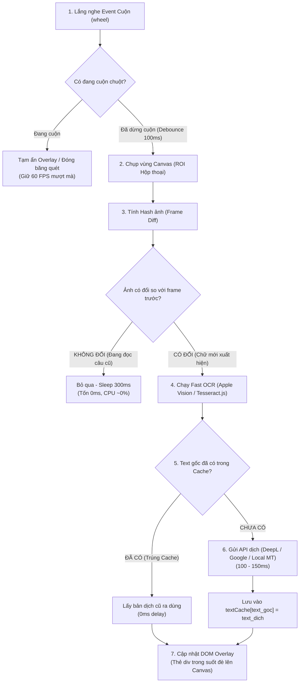

---
aliases:
  - Web Canvas Game Realtime Translator
  - Dịch Game Web Canvas Realtime
date: 2026-10-20
tags:
  - ai-idea
  - game-translator
  - ocr
  - web-canvas
parent: "[[Pdf AI.md]]"
---

# Web Canvas Game Realtime Translator (macOS & Windows)

> **Review 2026-10-20:** Các phần bên dưới là ý tưởng ban đầu, chưa phải
> implementation đã kiểm chứng. Các con số latency, RAM, CPU và nhận định
> chất lượng engine không phải benchmark của dự án. Xem phần review thực nghiệm
> cuối tài liệu trước khi triển khai; skeleton hiện chưa dịch được game.
>
> **Bản chạy được sau review:** xem [TRANSLATOR.md](TRANSLATOR.md) và
> `tools/game_translator.py`. Đã có OCR, máy dịch thật, glossary, cache, overlay
> và flow kiểm chứng trên server CN. Những nhận xét “chưa có backend” ở phần
> review bên dưới mô tả trạng thái trước lần triển khai này.

Tài liệu tổng hợp kiến trúc, giải pháp kỹ thuật, phân tích tối ưu hóa và danh sách các repository / công cụ tham khảo cho bài toán **dịch thời gian thực (realtime) game chạy trên nền tảng Web Canvas** (chơi chủ yếu trên macOS và Windows, độ trễ mục tiêu ~100ms - 300ms, hỗ trợ overlay đè lên khung game).

---

## 1. Yêu cầu & Ràng buộc cốt lõi

* **Nền tảng mục tiêu:** Trình duyệt web (HTML5 `<canvas>`, WebGL / PixiJS / Phaser / Unity WebGL).
* **Hệ điều hành:** macOS (chính, chip Apple Silicon) và Windows.
* **Độ trễ (Latency):** 100ms – 300ms (cho phép độ trễ nhẹ nhưng không được khựng khung hình).
* **Trải nghiệm UI:** Cần hiển thị **Overlay chữ dịch trong suốt** đè trực tiếp lên vị trí hộp thoại game (người chơi vẫn click chuột, tương tác bình thường xuyên qua overlay).
* **Thách thức lớn nhất:** Text mô tả dài phải cuộn (scroll) trong Canvas dễ làm overlay bị chớp giật (flicker), lệch dòng và ngốn CPU.

---

## 2. Danh mục Repo & Công cụ Tham khảo

### A. OCR Engines (Nhận diện chữ)
* **[PaddleOCR](https://github.com/PaddlePaddle/PaddleOCR)**: Bộ công cụ OCR mã nguồn mở của Baidu. Nhận diện cực mạnh tiếng Trung / Nhật / Hàn (CJK) và các font chữ game cách điệu, uốn lượn. Hỗ trợ cross-platform (Python backend).
* **[Tesseract.js](https://github.com/naptha/tesseract.js)**: Port Tesseract sang WebAssembly (WASM SIMD). Chạy trực tiếp 100% trong trình duyệt web, không cần server ngoài. Rất tốt cho tiếng Anh / chữ Latin.
* **Apple Vision Framework (`VNRecognizeTextRequest`)**: API OCR có sẵn tích hợp sâu trong macOS. Chạy trực tiếp trên Apple Silicon Neural Engine (NPU), thời gian nhận diện chỉ tốn **5ms – 15ms**, siêu nhẹ và không tốn pin.
* **Windows Media OCR**: Engine OCR tích hợp sẵn của Windows 10/11, nhận diện nhanh (~20-40ms).

### B. Game Translators & Screen OCR Tools
* **[Translumo](https://github.com/ramjke/Translumo)**: Tool dịch màn hình game real-time qua overlay trong suốt (.NET / C#). Tích hợp Windows OCR, Tesseract, EasyOCR. Rất mượt nhưng chỉ hỗ trợ **Windows-only**.
* **[MORT](https://github.com/killkimno/MORT)**: Monkeyhead's OCR Realtime Translator. Tool dịch game real-time cổ điển, vẽ overlay đè khung chat, Windows-only.
* **[LunaTranslator](https://github.com/HIllya51/LunaTranslator)**: Công cụ all-in-one thế hệ mới cho Visual Novel / PC game. Hỗ trợ cả Hook bộ nhớ RAM lẫn OCR fallback. Windows native (chạy qua Wine trên Linux).
* **[Bob](https://github.com/ripperhe/Bob)**: Ứng dụng dịch thuật số 1 trên macOS. Hỗ trợ Apple OCR + nhiều plugin dịch (DeepL, Google, LLM). Phù hợp gọi phím tắt dịch popup.
* **[Immersive Translate](https://immersivetranslate.com/)**: Extension trình duyệt dịch web, PDF, và truyện tranh/manga. Hỗ trợ đa nền tảng nhưng tối ưu cho đọc tài liệu tĩnh hơn là game liên tục.
* **[XUnity.AutoTranslator](https://github.com/bbepis/XUnity.AutoTranslator)**: Tool hook dịch trực tiếp vào runtime Unity (dành cho game Unity PC native qua BepInEx).

### C. Dịch thuật tốc độ cao (Fast MT / Offline Engines)
* **[Bergamot Translator](https://github.com/browsermt/bergamot-translator)**: Engine dịch offline của Mozilla Firefox chạy hoàn toàn bằng WebAssembly trong trình duyệt. Không cần mạng, độ trễ siêu thấp.
* **[Transformers.js](https://github.com/xenova/transformers.js)**: Chạy các model AI cục bộ (như MarianMT, NLLB) ngay trong Web Browser qua WebGPU / WASM.
* **DeepL API**: Dịch máy chất lượng cao nhất hiện nay, thời gian phản hồi API trung bình khoảng 80ms – 150ms.
* **Google Cloud Translation API**: Ổn định, ping thấp, hỗ trợ mọi ngôn ngữ.

---

## 3. Kiến trúc Luồng Xử lý Tối ưu (Pipeline Architecture)

Để giải quyết vấn đề nóng máy và độ trễ dưới 300ms, hệ thống bổ sung **Image Hash (chống cháy CPU)** và **Debounce Scroll (chống giật khi cuộn)**:



---

## 4. Giải quyết 2 "Nút Thắt" Kỹ Thuật

### 1. Tại sao không dùng `setInterval(300)` thuần túy?
* **Rủi ro cháy CPU:** Nếu bạn đứng đọc thoại 10 giây, `setInterval(300)` sẽ gọi hàm OCR vô ích hơn 33 lần liên tiếp (dù kết quả trả về cùng 1 câu).
* **Rủi ro nghẽn cổ chai:** Khi mạng lag hoặc OCR xử lý mất 350ms, interval tiếp theo sẽ bắn đè lên, gây giật lag trình duyệt.
* **Giải pháp:** Sử dụng **cờ khoá (`isProcessing`)** kết hợp **so sánh ảnh (Image Hash)**. Nếu ảnh chưa đổi $\rightarrow$ không gọi OCR $\rightarrow$ CPU tiêu thụ 0%.

### 2. Giải quyết vấn đề cuộn (Scroll) text dài trong Canvas
* **Bản chất:** Canvas không cuộn DOM thật mà vẽ lại pixel ở 60fps. Vừa cuộn vừa OCR sẽ khiến overlay bị giật cục, trễ pha và chớp nháy (flicker).
* **Giải pháp 1 (Debounce Scroll):** Tạm ẩn/đóng băng overlay khi ngón tay đang lăn bánh xe chuột; vừa buông tay dừng cuộn ~100ms thì mới chụp frame tĩnh và dịch.
* **Giải pháp 2 (Side Panel):** Thay vì dán đè pixel lên canvas, hiển thị bản dịch ở một khung phụ đề riêng bên cạnh hoặc phía dưới canvas.
* **Giải pháp 3 (Hook Data 0ms):** Nếu game dùng 2D Context, hook trực tiếp `CanvasRenderingContext2D.prototype.fillText` qua Tampermonkey để lấy nguyên chuỗi văn bản dài trước khi nó được render.

---

## 5. Mã Mẫu Kiến Trúc (Skeleton Script)

Mẫu script Userscript (Tampermonkey) hoặc Extension chạy nội bộ trong trình duyệt:

```javascript
// ==UserScript==
// @name         Web Canvas Game Realtime Translator
// @match        *://your-game-site.com/*
// @grant        none
// ==/UserScript==

(function() {
    'use strict';

    const canvas = document.querySelector('canvas');
    if (!canvas) return;

    // 1. Tạo DOM Overlay trong suốt đè lên Canvas
    const overlay = document.createElement('div');
    overlay.style.position = 'absolute';
    overlay.style.left = canvas.offsetLeft + 'px';
    overlay.style.top = canvas.offsetTop + 'px';
    overlay.style.width = canvas.offsetWidth + 'px';
    overlay.style.height = canvas.offsetHeight + 'px';
    overlay.style.pointerEvents = 'none'; // Click chuột xuyên qua overlay
    overlay.style.zIndex = '99999';
    overlay.style.display = 'flex';
    overlay.style.flexDirection = 'column';
    overlay.style.justifyContent = 'flex-end'; // Hiển thị phụ đề ở đáy
    document.body.appendChild(overlay);

    const subtitleBox = document.createElement('div');
    subtitleBox.style.background = 'rgba(0, 0, 0, 0.75)';
    subtitleBox.style.color = '#fff';
    subtitleBox.style.padding = '8px 16px';
    subtitleBox.style.fontSize = '16px';
    subtitleBox.style.margin = '20px';
    subtitleBox.style.borderRadius = '6px';
    overlay.appendChild(subtitleBox);

    // 2. State & Cache
    let isProcessing = false;
    let isScrolling = false;
    let scrollTimer = null;
    let lastImageHash = null;
    const textCache = new Map();

    // 3. Xử lý sự kiện Scroll (Debounce)
    canvas.addEventListener('wheel', () => {
        isScrolling = true;
        subtitleBox.style.opacity = '0.3'; // Làm mờ khi đang cuộn
        clearTimeout(scrollTimer);
        scrollTimer = setTimeout(() => {
            isScrolling = false;
            subtitleBox.style.opacity = '1';
        }, 120); // Dừng cuộn 120ms thì kích hoạt lại
    }, { passive: true });

    // 4. Hàm cắt ảnh vùng hội thoại (ROI: 30% đáy màn hình)
    function captureRoi(cvs) {
        const offCanvas = document.createElement('canvas');
        const ctx = offCanvas.getContext('2d');
        const roiHeight = cvs.height * 0.3;
        offCanvas.width = cvs.width;
        offCanvas.height = roiHeight;
        ctx.drawImage(cvs, 0, cvs.height - roiHeight, cvs.width, roiHeight, 0, 0, cvs.width, roiHeight);
        return offCanvas;
    }

    // 5. Hàm tính hash ảnh nhanh (lấy mẫu pixel)
    function getImageHash(cvs) {
        const ctx = cvs.getContext('2d');
        const sample = ctx.getImageData(0, 0, cvs.width, cvs.height).data;
        let hash = 0;
        for (let i = 0; i < sample.length; i += 64) { // Lấy mẫu mỗi 16 pixel
            hash = ((hash << 5) - hash) + sample[i];
            hash |= 0;
        }
        return hash;
    }

    // 6. Vòng lặp quét an toàn (Lock + 300ms Delay)
    async function mainLoop() {
        if (isProcessing || isScrolling) {
            setTimeout(mainLoop, 150);
            return;
        }

        const roi = captureRoi(canvas);
        const currentHash = getImageHash(roi);

        // Chốt chặn chống cháy CPU: Ảnh không đổi thì dừng
        if (currentHash === lastImageHash) {
            setTimeout(mainLoop, 300);
            return;
        }

        isProcessing = true;
        lastImageHash = currentHash;

        try {
            // Bước A: Chạy OCR (Ví dụ gửi ảnh về local server hoặc Tesseract.js)
            const rawText = await fakeOcrApi(roi);

            if (rawText && rawText.trim().length > 0) {
                // Bước B: Kiểm tra Cache
                if (textCache.has(rawText)) {
                    subtitleBox.innerText = textCache.get(rawText);
                } else {
                    // Bước C: Gọi API dịch
                    const translated = await fakeTranslateApi(rawText);
                    textCache.set(rawText, translated);
                    subtitleBox.innerText = translated;
                }
            }
        } catch (err) {
            console.error("Lỗi pipeline dịch:", err);
        } finally {
            isProcessing = false;
            setTimeout(mainLoop, 300);
        }
    }

    // Giả lập OCR & Translate
    async function fakeOcrApi(roiCanvas) { /* ... gọi backend OCR ... */ return ""; }
    async function fakeTranslateApi(text) { /* ... gọi DeepL / Google ... */ return text; }

    mainLoop();
})();
```

## 6. Review triển khai cho Haunted Room — 2026-10-20

### Kết quả quan sát trực tiếp

- Chạy Chrome headless bằng Playwright trên Windows, viewport 640×720,
  mở URL CN đã có trong `tools/hauntedroom/core/cli.py`.
- Chụp được màn hình chọn server / bắt đầu game. Trang chính có một canvas;
  iframe SDK đăng nhập nằm ở origin khác.
- Hook `fillText` và `strokeText` trước khi tải trang lấy được chữ phồn thể:
  `開始遊戲` (Bắt đầu chơi), `選擇伺服器` (Chọn máy chủ),
  `切換帳號` (Đổi tài khoản), `公 告` (Thông báo), `客 服` (Hỗ trợ).
- Có cả `切換語言` (Đổi ngôn ngữ) trong các chuỗi đã vẽ, nhưng chưa chứng minh
  có nút hiện trên màn hình hoặc có tiếng Việt. Chuỗi thu được có thể thuộc
  texture/offscreen canvas hoặc màn hình cũ; không dùng chúng làm bằng chứng
  rằng một control đang hiển thị.
- Screenshot ban đầu: `.tmp/translator-review/cn-page.png`; dữ liệu:
  `.tmp/translator-review/probe.json`. Không đưa dữ liệu phiên game vào git.
- Lần chạy `--enter-game` đã đi từ entry đến đoạn cốt truyện mở đầu (ảnh có
  nút `跳過劇情`), thu được 128 chuỗi sau khi xóa buffer entry. Bằng chứng:
  `.tmp/translator-review/after-entry.png` và `after-entry.json`.
  Chưa xác nhận lobby hoặc flow đọc mô tả tướng.

Script tái hiện, dùng chung API trên Windows/macOS:

```shell
uv run python tools/translator_probe.py
# Thêm bước click vào game tại viewport đã kiểm tra:
uv run python tools/translator_probe.py --enter-game
```

Script là probe phục vụ review, chưa có OCR, dịch tự động hay assertion game
đã vào lobby. `--enter-game` dùng tọa độ cố định sau khi kiểm tra các chuỗi
entry, nên vẫn cần xem `after-entry.png` để xác định trạng thái thật. Probe
dùng browser context mới, không sử dụng profile tài khoản đang chơi.

### Những lỗi cần sửa trước khi dùng skeleton

1. `fakeOcrApi()` luôn trả chuỗi rỗng, `fakeTranslateApi()` trả nguyên văn:
   chưa có flow dịch end-to-end.
2. `querySelector('canvas')` chạy một lần có thể bỏ lỡ canvas tạo muộn hoặc
   chọn nhầm canvas. Cần chọn đúng frame/canvas và xử lý thay thế sau navigation.
3. `captureRoi()`/hash nằm ngoài `try`: lỗi đọc ảnh có thể dừng vòng lặp.
   Đọc pixel từ canvas bị taint sẽ ném `SecurityError`; dùng browser screenshot
   làm đường capture chính. [MDN: canvas và CORS](https://developer.mozilla.org/en-US/docs/Web/HTML/How_to/CORS_enabled_image).
4. Ghi `lastImageHash` trước khi OCR/dịch thành công khiến frame lỗi không được
   thử lại nếu ảnh giữ nguyên. Cần tách trạng thái pending/success và retry có backoff.
5. OCR rỗng không xóa bản dịch cũ. Kết quả dịch chậm có thể hiện trên màn hình
   mới: cần generation ID, loại kết quả cũ và invalidation khi chuyển cảnh/cuộn.
6. Hash chỉ lấy mẫu kênh đỏ có thể bỏ sót thay đổi chữ; nền animation lại làm
   hash đổi liên tục. Dùng ROI tùy màn hình, kiểm tra ổn định theo nhiều frame
   và đo chi phí capture/diff. Bỏ OCR không đồng nghĩa CPU bằng 0%.
7. Poll 300 ms cộng capture/OCR/network/render không thể bảo đảm tổng dưới
   300 ms. Đo p50/p95 riêng cache hit/miss, cold/warm; tính từ lúc chữ xuất hiện.
8. `offsetLeft/Top` không đủ với iframe, CSS scale, resize, fullscreen và Retina.
   Thống nhất tọa độ CSS, bounding rect của canvas và kích thước ảnh OCR.
9. Khi chụp browser screenshot phải loại overlay khỏi ảnh đầu vào, nếu không
   OCR có thể đọc lại chữ dịch. Dùng side panel nằm ngoài ROI là bước đầu dễ kiểm tra.
10. Hook 2D có thể lấy text để tạo texture, không cho biết vị trí cuối trên WebGL.
    Nó cũng có thể bỏ sót bitmap fonts/worker; không bỏ đường OCR fallback.

### Kiến trúc đề xuất

Ưu tiên kiểm tra text sẵn có và khả năng đổi ngôn ngữ trong game. Thử hook qua
`context.add_init_script` từ trước navigation để thu cả frame mới; giữ nguyên
ngữ nghĩa hàm vẽ, giới hạn bộ nhớ, không sửa chuỗi game trong bước khảo sát.
[Playwright: init script](https://playwright.dev/python/docs/api/class-browsercontext#browser-context-add-init-script).

Với phần chữ không lấy được: screenshot ROI → OCR có box/confidence → chuẩn hóa
và cache theo text/ngôn ngữ/glossary/provider → dịch → side panel hoặc overlay
`pointer-events:none`. Chạy OCR ngoài event loop Playwright, chỉ một job đang chạy,
ưu tiên frame mới nhất, có timeout và bỏ kết quả đã lỗi thời. API key giữ ở Python,
không inject vào trang game.

Tái sử dụng `tools/hauntedroom/core/vision.py` đang chụp `scale="css"`.
Playwright hỗ trợ screenshot trang, element và vùng crop; chưa có bằng chứng cần
capture cửa sổ hệ điều hành cho màn hình đã thử.
[Playwright: screenshots](https://playwright.dev/python/docs/screenshots).

Windows/macOS dùng chung capture Playwright và DOM side panel. Nếu cần native
window capture thì thêm adapter riêng cho từng OS, xử lý quyền macOS và chuyển
đổi tọa độ pixel/point; không đưa Win32 vào core. OCR cũng là adapter: chọn một
backend dùng chung trước, Apple Vision/Windows OCR là tối ưu tùy chọn. Phải hỏi
runtime về ngôn ngữ Apple Vision hỗ trợ, không suy ra từ máy có Apple Silicon.
[Apple: VNRecognizeTextRequest](https://developer.apple.com/documentation/vision/vnrecognizetextrequest).

### Điều kiện để gọi là success

- Vào đúng server và màn hình cần đọc, có screenshot nguồn cùng text nhận diện.
- Dịch câu mới bằng backend thật, đúng ngôn ngữ đích; bảng từ viết tay chỉ kiểm tra UI.
- Kiểm tra menu, mô tả dài, cuộn, đóng/mở popup; không hiện bản dịch của cảnh cũ.
- Click vẫn đến game; overlay không đi vào input OCR; cache giảm số lần gọi backend.
- Mất mạng, OCR lỗi và frame giữ nguyên sau lỗi đều phục hồi được.
- Lưu timing từng stage và ảnh kết quả; chạy cùng flow trên Windows và macOS thật.

Hiện mới xác nhận capture và lấy một phần text trên Windows. Chưa xác nhận
dịch tự động, chất lượng OCR, latency mục tiêu hoặc vận hành trên macOS.
